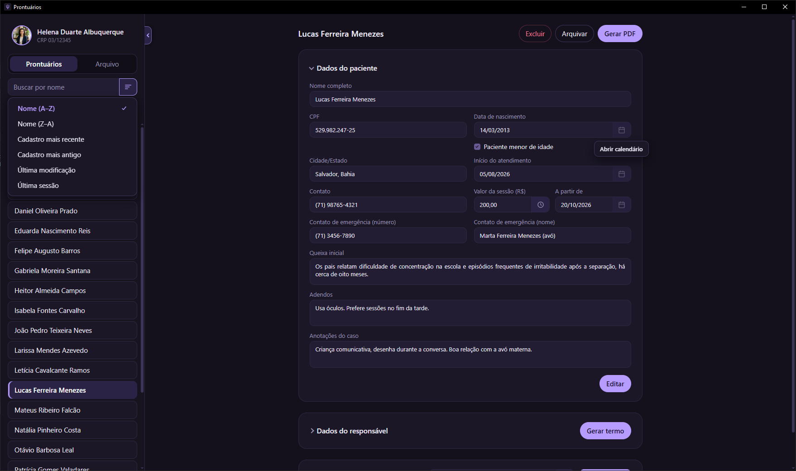
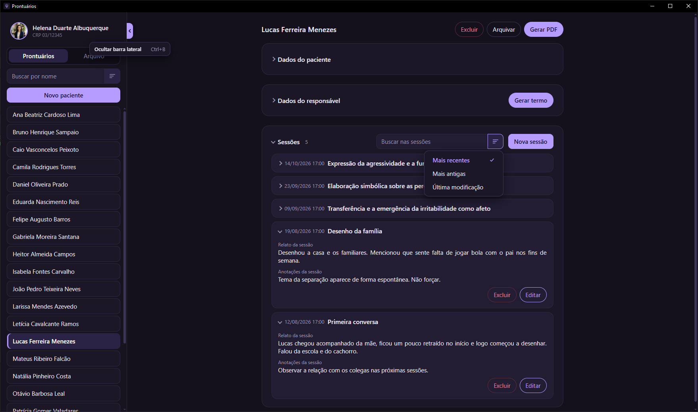
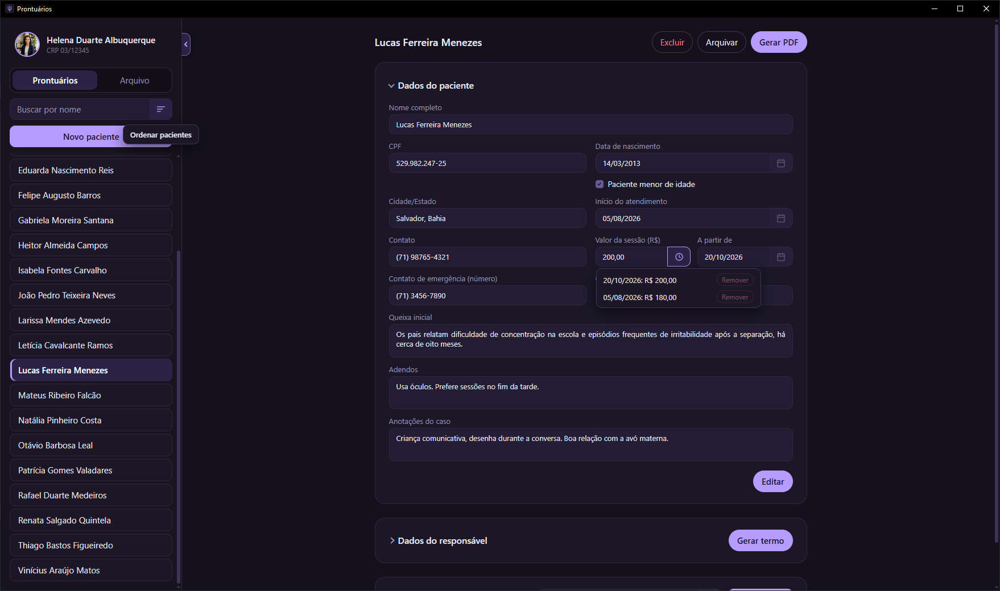
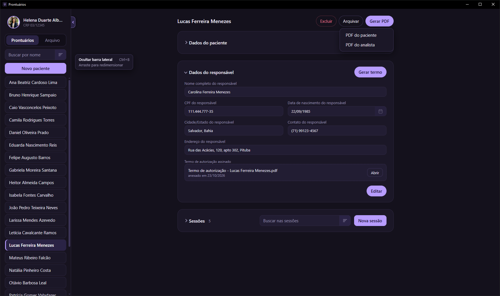
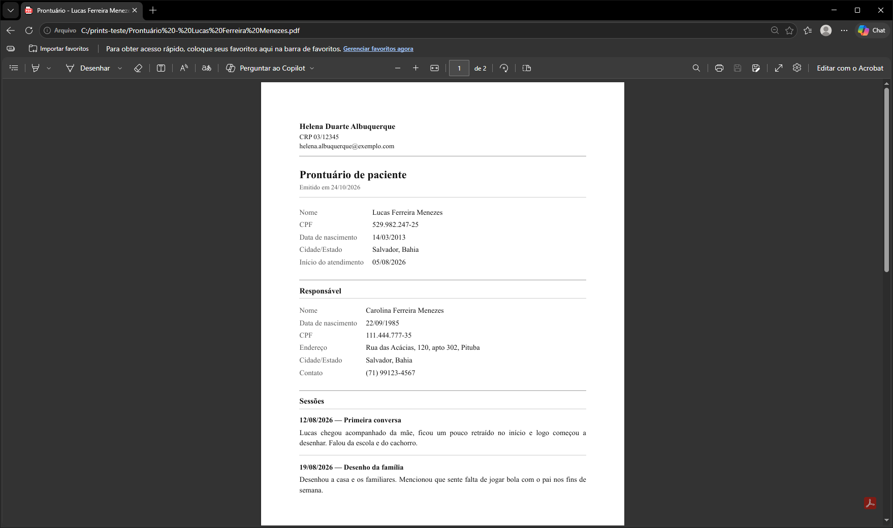
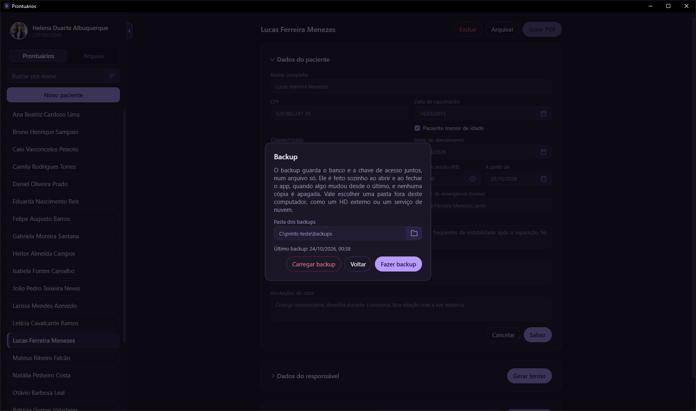
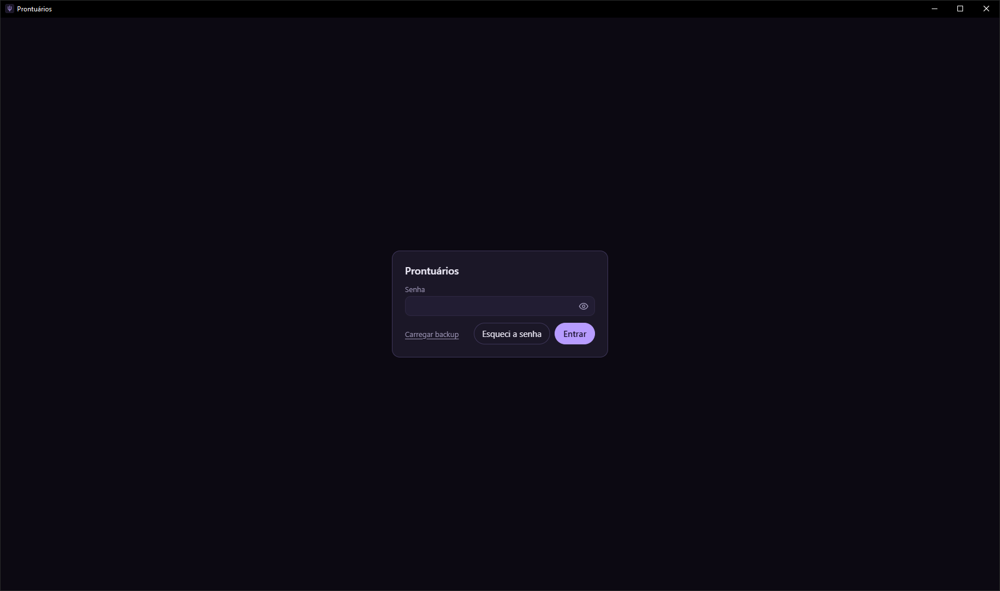
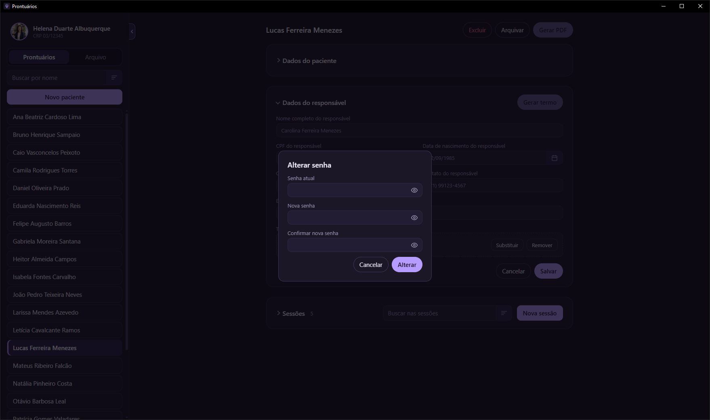
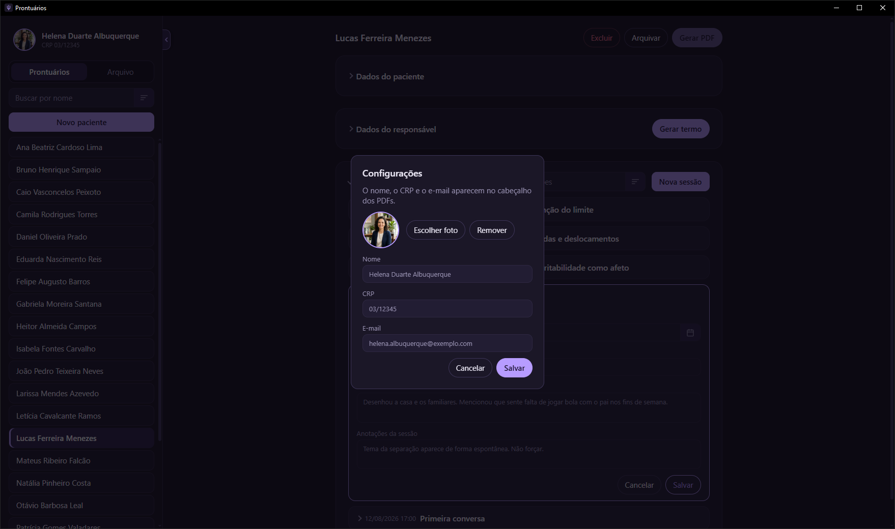

# Prontuários

Aplicativo de desktop para Windows para guardar prontuários de pacientes em atendimento psicanalítico. Os dados ficam somente no computador de quem usa, num banco criptografado, protegido por uma senha do app.

Fiz para uma pessoa psicanalista que queria deixar de usar planilhas e papel, e que o prontuário não saísse do computador. O app não tem conexão com internet.



## O que o app faz

- Cadastro do paciente: nome, CPF, data de nascimento, cidade e estado, queixa inicial, início do atendimento, celular, contato de emergência e adendos.
- Sessões dentro da ficha, cada uma com data e hora, título, relato e anotações. Dá para buscar pelo texto das sessões.
- Valor da sessão por paciente, com histórico: ao reajustar, os valores antigos continuam registrados.
- Arquivar paciente que parou de comparecer, sem apagar nada, e excluir quando for mesmo o caso. Nada é arquivado ou excluído sozinho.
- Dois PDFs por paciente. O do paciente leva os dados cadastrais e o relato das sessões, sem anotações, valor e adendos. O do analista leva tudo.
- Paciente menor de idade: marcando a caixa, aparece a seção do responsável, onde dá para anexar o termo assinado e gerar o termo de autorização já preenchido.
- Senha do app e chave de recuperação, para o caso de esquecer a senha. O nome, o CRP e o e-mail do profissional ficam em "Configurações" e saem no cabeçalho dos PDFs.
- Backup num arquivo só, automático ao abrir, ao fechar e ao sair, mas apenas quando algo mudou, e também manual. Para restaurar, "Carregar backup" na tela de senha ou na janela de backup, em qualquer computador com o app instalado.

















Todos os dados dos prints são fictícios, inclusive a foto de perfil, que foi gerada por IA.

## Como instalar

1. Baixe o `Prontuarios-Setup-1.0.0.exe` na página de Releases do repositório.
2. Confira o hash, se quiser. No PowerShell:

   ```powershell
   Get-FileHash .\Prontuarios-Setup-1.0.0.exe -Algorithm SHA256
   ```

   O resultado tem que ser igual ao SHA-256 que está na descrição da Release.
3. Execute o instalador. Ele instala só para o usuário atual e não pede administrador.
4. Na primeira vez que o app abrir, ele pede para criar a senha e mostra a chave de recuperação. Guarde a chave de forma segura.

### Aviso do SmartScreen

O instalador não é assinado, porque um certificado de assinatura custa caro para um projeto pequeno. Por isso o Windows mostra a tela "O Windows protegeu seu computador". Clique em **Mais informações** e depois em **Executar assim mesmo**.

## Rodar em desenvolvimento

Precisa do Node 22.12 ou mais recente.

```powershell
npm install
npm run dev
```

Com o servidor do Vite rodando, abra outro PowerShell na mesma pasta:

```powershell
$env:VITE_DEV_SERVER_URL = "http://localhost:5173"
npm start
```

Para gerar o instalador:

```powershell
npm run dist
```

O instalador sai na pasta `out`. Se der erro de permissão (EPERM), gere em outra pasta, fora de Documents:

```powershell
npm run dist -- --config.directories.output=C:\build-prontuarios
```

## Como foi feito

Electron 44 com Vue 3 e Vite na tela. O banco é SQLite criptografado, com o `better-sqlite3-multiple-ciphers`. O Electron cuida do banco, dos backups e dos PDFs, e a tela conversa com ele apenas através do preload.

## Limitações

- Trocar a senha não troca a chave do banco. Um backup antigo, feito com a senha antiga, continua abrindo o banco.
- Não existe tamanho mínimo de senha.
- O termo anexado e os PDFs passam por um arquivo sem criptografia. O termo fica numa pasta temporária enquanto o app está aberto.
- Sem a senha e sem a chave de recuperação, os dados não têm como ser recuperados.
- A pasta de backups cresce conforme a frequência de uso: o app não apaga nada sozinho, então a limpeza dos backups antigos fica por conta de quem usa.
- Antes de atualizar o banco para uma versão nova, o app também guarda uma cópia dele ao lado do banco, na pasta de dados do app (dentro de `%APPDATA%`), com o nome terminando em `.antes-da-vNN`.

## Licença

Veja o arquivo `LICENSE`.